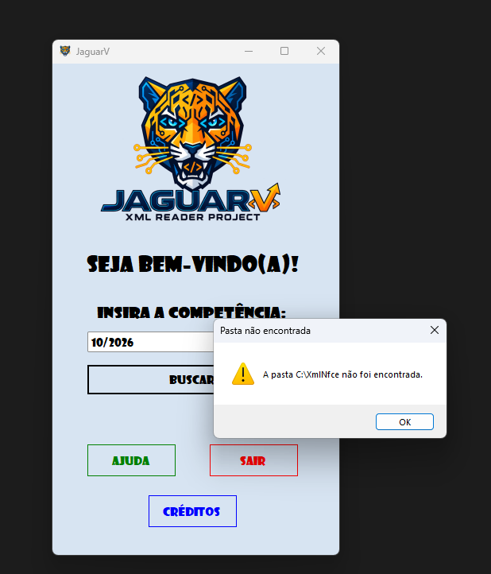
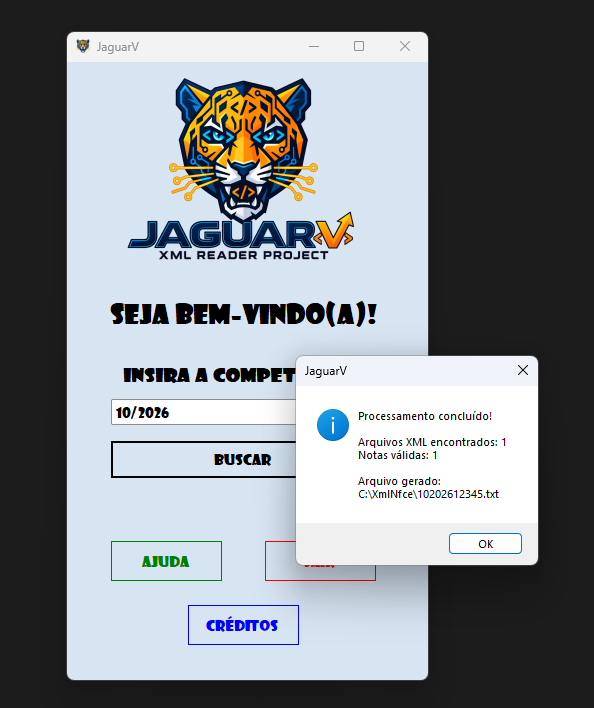
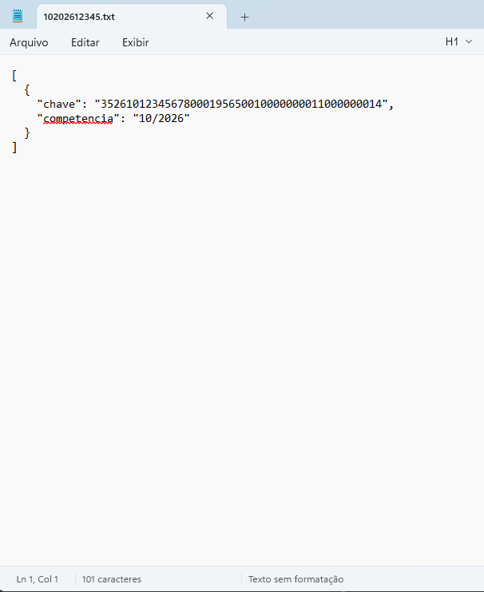
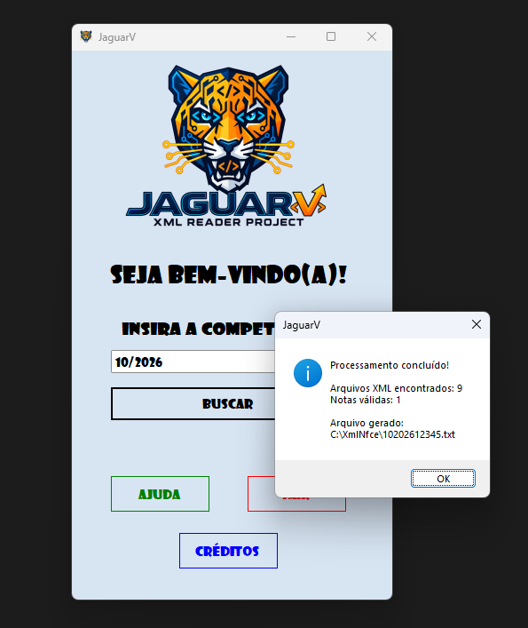
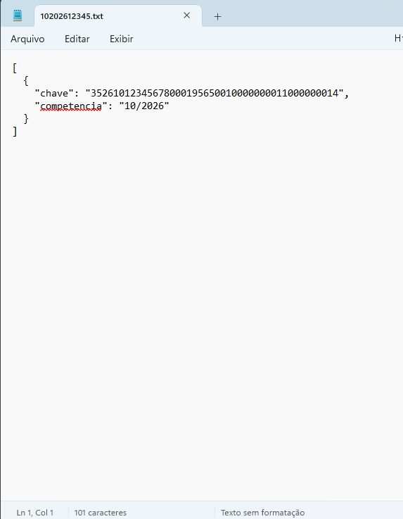
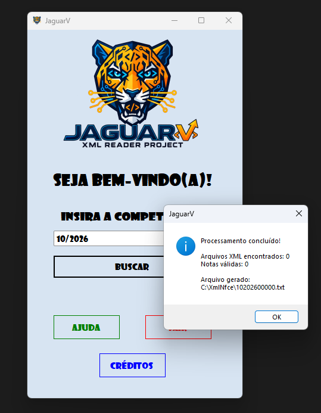
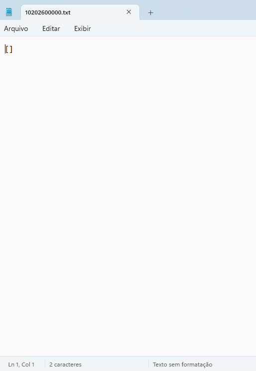
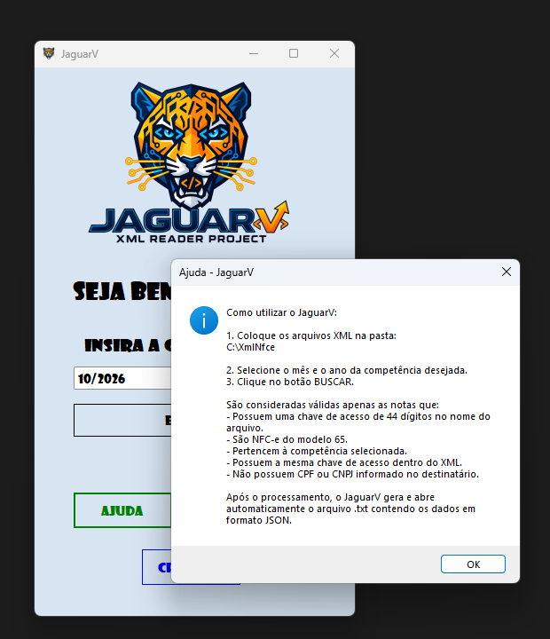
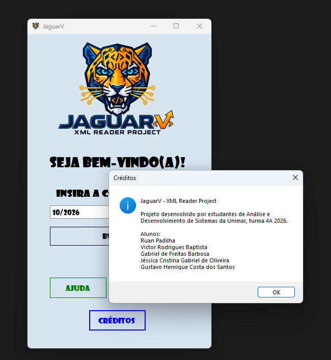
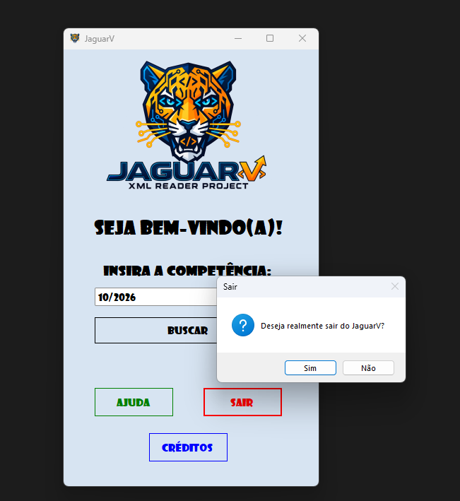

<p align="center">
  
</p>

# Relatório de Testes (QA) — JaguarV

## 1. Casos de Teste (CTs)

Os testes foram feitos direto no app (Windows Forms), usando a pasta `C:\XmlNfce` e a competência **10/2026**.

| ID       | Título                          | Pré-condição                                                                 | Passos / Entradas                                   | Resultado Esperado                                                                                   | Resultado Obtido                                                                                   |
| -------- | ------------------------------- | ---------------------------------------------------------------------------- | --------------------------------------------------- | ---------------------------------------------------------------------------------------------------- | -------------------------------------------------------------------------------------------------- |
| **CT01** | Pasta inexistente               | A pasta `C:\XmlNfce` não existe.                                             | 1. Clicar em **BUSCAR**.                            | Mostrar um aviso dizendo que a pasta não foi encontrada.                                             | Aviso **"Pasta não encontrada: A pasta C:\XmlNfce não foi encontrada."**                           |
| **CT02** | NFC-e válida                    | 1 XML válido em `C:\XmlNfce` (modelo 65, 10/2026, sem CPF/CNPJ).             | 1. Competência **10/2026**.<br>2. Clicar em **BUSCAR**. | Aprovar a nota, mostrar o resumo e gerar/abrir o `10202612345.txt`.                                  | **Arquivos XML encontrados: 1 / Notas válidas: 1**. Arquivo aberto no Bloco de Notas com a nota.   |
| **CT03** | Lote com notas inválidas        | 9 XMLs em `C:\XmlNfce`: 1 válido e 8 com problemas (ver Massa de Dados).    | 1. Competência **10/2026**.<br>2. Clicar em **BUSCAR**. | Aprovar só a nota válida, descartar as outras e não travar com o XML corrompido.                     | **Arquivos XML encontrados: 9 / Notas válidas: 1**. Só a nota válida no `.txt`.                    |
| **CT04** | Pasta vazia                     | A pasta `C:\XmlNfce` existe, mas está vazia.                                 | 1. Clicar em **BUSCAR**.                            | Gerar o arquivo `10202600000.txt` com a lista vazia.                                                 | **Arquivos XML encontrados: 0 / Notas válidas: 0**. Arquivo aberto com `[]`.                       |
| **CT05** | Botão Ajuda                     | App aberto.                                                                  | 1. Clicar em **AJUDA**.                             | Mostrar como usar o app e quais notas são consideradas válidas.                                      | Janela **"Ajuda - JaguarV"** com o passo a passo e as regras.                                      |
| **CT06** | Botão Créditos                  | App aberto.                                                                  | 1. Clicar em **CRÉDITOS**.                          | Mostrar o nome do projeto e dos integrantes.                                                         | Janela **"Créditos"** com os 5 integrantes.                                                        |
| **CT07** | Botão Sair                      | App aberto.                                                                  | 1. Clicar em **SAIR**.                              | Pedir confirmação antes de fechar.                                                                   | Pergunta **"Deseja realmente sair do JaguarV?"** com Sim/Não.                                      |

---

# 2. Massa de Dados

Todos os XMLs usados de teste estão no arquivo [`XmlNfce.zip/`](XmlNfce.zip) no repositório, baixe ele e extraia em `C:\XmlNfce` no seu computador.

## XML válido (CT02 e CT03)

**Arquivo:** `35261012345678000195650010000000011000000014-procNFe.xml`

```xml
<?xml version="1.0" encoding="utf-8"?>
<nfeProc xmlns="http://www.portalfiscal.inf.br/nfe">
  <NFe>
    <infNFe Id="NFe35261012345678000195650010000000011000000014">
      <ide>
        <mod>65</mod>
        <serie>1</serie>
        <dhEmi>2026-10-15T10:00:00-03:00</dhEmi>
      </ide>
      <dest></dest>
      <total>
        <ICMSTot>
          <vNF>150.00</vNF>
        </ICMSTot>
      </total>
    </infNFe>
  </NFe>
</nfeProc>
```

Por que ele passa:

* O nome do arquivo tem a chave de 44 dígitos;
* A chave indica competência `2610` (10/2026) e modelo `65`;
* A chave do nome é igual ao `Id` do `<infNFe>` (sem o `NFe`);
* A tag `<mod>` é `65`;
* O `<dhEmi>` é de outubro de 2026;
* O `<dest>` não tem CPF nem CNPJ.

## Lote misto (CT03)

| Arquivo                          | O que tem de errado                              | Resultado  |
| -------------------------------- | ------------------------------------------------ | ---------- |
| `...0014-valida.xml`             | Nada                                             | Aprovada   |
| `...0019-chave-modelo55.xml`     | A chave indica modelo 55                         | Descartada |
| `nota-sem-chave-no-nome.xml`     | Não tem a chave no nome do arquivo               | Descartada |
| `...0016-chave-divergente.xml`   | A chave do nome é diferente da chave do XML      | Descartada |
| `...0013-mod55-no-xml.xml`       | A tag `<mod>` é 55                               | Descartada |
| `...0010-data-fora.xml`          | Emitida em 11/2026                               | Descartada |
| `...0018-com-cpf.xml`            | Tem CPF no destinatário                          | Descartada |
| `...0015-com-cnpj.xml`           | Tem CNPJ no destinatário                         | Descartada |
| `...0012-corrompido.xml`         | XML quebrado (`<nfeProc><NFe>`)                  | Ignorado sem travar |

---

# 3. Arquivo de Saída

O app gera um `.txt` com o conteúdo em JSON, na própria pasta `C:\XmlNfce`.

O nome segue o padrão **MMAAAA + 5 primeiros dígitos do CNPJ** do emitente:

```text
10202612345.txt
```

Conteúdo gerado no CT02 e no CT03:

```json
[
  {
    "chave": "35261012345678000195650010000000011000000014",
    "competencia": "10/2026"
  }
]
```

Quando não tem nenhuma nota válida (CT04), o CNPJ vira `00000` e a lista vem vazia:

```text
10202600000.txt  →  []
```

---

# 4. Resultados e Evidências

## CT01 — Pasta inexistente

**Status:** Aprovado

Cliquei em BUSCAR sem a pasta `C:\XmlNfce` existir. O app mostrou o aviso e não fechou.



---

## CT02 — NFC-e válida

**Status:** Aprovado

Com 1 XML válido na pasta, o app encontrou 1 arquivo, aprovou 1 nota e abriu o `.txt` gerado.





---

## CT03 — Lote com notas inválidas

**Status:** Aprovado

Com 9 XMLs na pasta, só 1 foi aprovado. Os outros 8 foram descartados, cada um por um motivo diferente, e o XML corrompido não travou o processamento.





---

## CT04 — Pasta vazia

**Status:** Aprovado

Com a pasta vazia, o app gerou o `10202600000.txt` com a lista vazia.





---

## CT05 — Botão Ajuda

**Status:** Aprovado



---

## CT06 — Botão Créditos

**Status:** Aprovado



---

## CT07 — Botão Sair

**Status:** Aprovado

O app pede confirmação antes de fechar. Clicando em **Não**, ele continua aberto; em **Sim**, fecha.



---

# 5. Testes Automatizados

Além dos testes manuais, o projeto `JaguarV.Tests` (xUnit) testa as regras direto no código, sem precisar abrir o app.

Para rodar:

```bash
dotnet test JaguarV.Tests/JaguarV.Tests.csproj
```

Ou no Visual Studio: **Teste → Gerenciador de Testes → Executar Todos**.

| ID       | O que testa                                                              | Status   |
| -------- | ------------------------------------------------------------------------ | -------- |
| **TA01** | Chave válida é aceita                                                    | Aprovado |
| **TA02** | Chave inválida é recusada (curta, com letra, modelo 55 ou outro mês)     | Aprovado |
| **TA03** | CNPJ e série são extraídos das posições certas da chave                  | Aprovado |
| **TA04** | Pasta inexistente gera erro                                              | Aprovado |
| **TA05** | Nota válida gera o arquivo com nome e conteúdo certos                    | Aprovado |
| **TA06** | Arquivo sem chave no nome é ignorado                                     | Aprovado |
| **TA07** | Chave do nome diferente da chave do XML é descartada                     | Aprovado |
| **TA08** | `<mod>` diferente de 65 é descartado                                     | Aprovado |
| **TA09** | Data de emissão fora da competência é descartada                         | Aprovado |
| **TA10** | Destinatário com CPF é descartado                                        | Aprovado |
| **TA11** | Destinatário com CNPJ é descartado                                       | Aprovado |
| **TA12** | XML corrompido não interrompe o processamento                            | Aprovado |
| **TA13** | Sem notas válidas, gera arquivo com `00000` e lista vazia                | Aprovado |

**Resultado:** 13 de 13 aprovados.

---

# 6. Resumo

| Caso     | Cenário                          | Status   |
| -------- | -------------------------------- | -------- |
| **CT01** | Pasta inexistente                | Aprovado |
| **CT02** | NFC-e válida                     | Aprovado |
| **CT03** | Lote com notas inválidas         | Aprovado |
| **CT04** | Pasta vazia                      | Aprovado |
| **CT05** | Botão Ajuda                      | Aprovado |
| **CT06** | Botão Créditos                   | Aprovado |
| **CT07** | Botão Sair                       | Aprovado |
| **TA01–TA13** | Testes automatizados        | Aprovado |

---

# 7. Conclusão

Todos os testes passaram. O JaguarV:

* Avisa quando a pasta não existe;
* Aprova só as NFC-e modelo 65 da competência escolhida e sem CPF/CNPJ;
* Confere se a chave do nome do arquivo bate com a chave do XML;
* Descarta as notas inválidas e não trava com XML corrompido;
* Gera o `.txt` com o nome e o conteúdo no formato certo, inclusive quando não tem nenhuma nota;
* Tem os botões de ajuda, créditos e sair funcionando.
