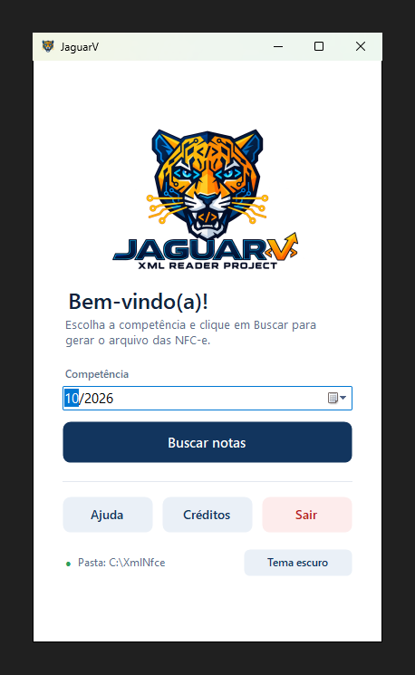
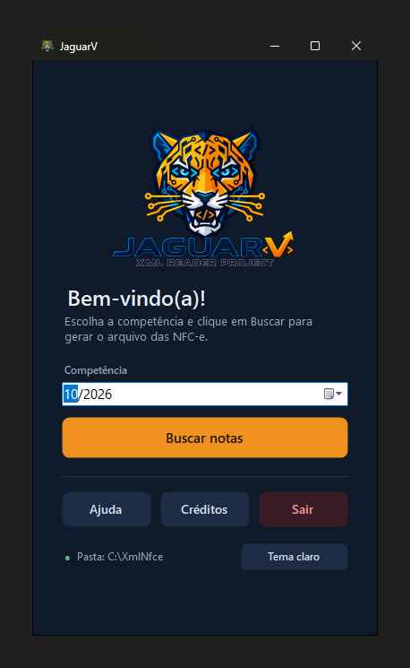
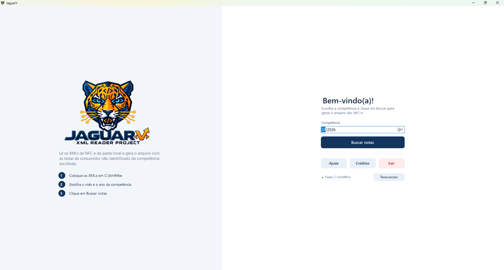

<p align="center">
  
</p>

# JaguarV — Documentação da Solução XML

**Integrantes:**

* Jéssica Cristina Gabriel de Oliveira
* Gustavo Henrique Costa dos Santos
* Ruan Padilha
* Gabriel de Freitas Barbosa
* Victor Rodrigues Baptista

**Termo/Curso:**

* 4° Termo A ADS — Unimar

---

## Introdução

A empresa emite todo dia centenas de **NFC-e (modelo 65)**, e os XMLs ficam guardados numa pasta local. Essas notas precisam ser conferidas para auditoria e enviadas para o sistema contábil, mas só as de **consumidor não identificado**, ou seja, **sem CPF nem CNPJ** do comprador.

Fazer isso na mão é demorado e fácil de errar. O **JaguarV** automatiza o processo: o usuário escolhe a competência (mês/ano), o app lê os XMLs da pasta `C:\XmlNfce`, aplica os filtros e gera um arquivo com as notas aprovadas.

O JaguarV é a nova versão do nosso projeto anterior, o **XMLAppReader**. A comparação entre os dois está no final deste documento, junto com a [última atualização](#última-atualização) do projeto.

---

# Visão geral do fluxo

O processamento começa no botão **Buscar notas** (`btnBuscar`) do `FormPrincipal`:

1. O usuário escolhe a competência no `DateTimePicker` (formato `MM/yyyy`);
2. O app converte a competência para `yyyy-MM`;
3. O `XmlService` lista os arquivos `.xml` da pasta `C:\XmlNfce`;
4. **Etapa 1:** cada arquivo passa por uma triagem pelo **nome**, sem abrir o XML;
5. **Etapa 2:** os que passam têm o **conteúdo** do XML validado;
6. As notas aprovadas são gravadas num `.txt` com conteúdo em JSON;
7. O app mostra quantos XMLs encontrou e quantas notas são válidas;
8. O arquivo gerado é aberto automaticamente.

## Organização do código

O código está dividido em camadas:

| Arquivo                          | Função                                                              |
| -------------------------------- | ------------------------------------------------------------------- |
| `Form1.cs` (`FormPrincipal`)     | Tela: competência, botões, troca de tema e layout responsivo        |
| `UI/Tema.cs`                     | Cores dos temas claro e escuro                                      |
| `UI/Controles.cs`                | Controles visuais próprios: botão arredondado e passo numerado      |
| `Services/XmlService.cs`         | Lê os XMLs, aplica os filtros e gera o arquivo de saída             |
| `Services/ChaveAcessoService.cs` | Valida a chave de acesso e extrai informações dela (CNPJ, série)    |
| `Models/NotaEnvio.cs`            | Modelo da nota aprovada (`Chave`, `Modelo` e `Competencia`)         |

---

# Estrutura da chave de acesso

A chave de acesso tem **44 dígitos**, e o JaguarV usa os campos que ela já traz:

| Posição | Campo                                        | Uso no JaguarV                                       |
| ------- | -------------------------------------------- | ---------------------------------------------------- |
| 1–2     | UF                                           | Não usado                                            |
| 3–6     | AAMM (ano e mês de emissão)                  | Validação da competência                             |
| 7–20    | CNPJ do emitente                             | 5 primeiros dígitos vão no nome do arquivo gerado    |
| 21–22   | Modelo                                       | Validação do modelo 65 (NFC-e)                       |
| 23–44   | Série, número, tipo de emissão, código e DV  | Não usado                                            |

---

# Etapa 1 — Filtro pelo nome do arquivo

O app procura no **nome** de cada arquivo uma sequência de **44 dígitos** (a chave de acesso) e verifica:

1. **Tem chave no nome?** Se não tiver, o arquivo é descartado;
2. **Formato:** a chave precisa ter 44 caracteres, todos números;
3. **Modelo 65:** o campo de modelo da chave precisa ser `65`;
4. **Competência:** o AAMM da chave precisa bater com o mês/ano escolhido. Exemplo: `10/2026` → `2610`.

Os arquivos reprovados aqui **nem são abertos**, o que deixa o processamento mais rápido em pastas grandes. No XMLAppReader, todos os arquivos eram carregados com `XDocument.Load()` antes de qualquer verificação.

---

# Etapa 2 — Validação do conteúdo do XML

Os arquivos que passaram na etapa 1 são carregados com:

```csharp
XDocument.Load
```

Isso acontece dentro de um `try/catch`, então um XML corrompido é ignorado sem parar o processamento dos outros.

Os elementos usam o namespace:

```text
http://www.portalfiscal.inf.br/nfe
```

e são buscados com `Descendants`. Os filtros rodam em sequência, e a primeira falha já descarta a nota:

## 1. Estrutura válida

Os elementos `infNFe` e `ide` precisam existir.

## 2. Confirmação da chave

O atributo `Id` do `infNFe` precisa existir. Tirando o prefixo `NFe`, ele deve ter **44 caracteres** e ser **igual à chave do nome do arquivo**.

## 3. Nota autorizada (cStat = 100)

O app procura o protocolo de autorização da SEFAZ (`<protNFe>` → `<infProt>`) e lê a tag `<cStat>`. A nota só segue se o `cStat` for **`100`** (Autorizado o uso da NF-e). Uma nota cancelada (`101`), denegada ou sem protocolo é descartada.

```xml
<protNFe>
  <infProt>
    <chNFe>35261012345678000195650010000000011000000014</chNFe>
    <cStat>100</cStat>
  </infProt>
</protNFe>
```

## 4. Modelo

A tag `<mod>` precisa ser `65`, confirmando o que a chave já dizia.

## 5. Data de emissão

O `<dhEmi>` precisa existir e é convertido com:

```csharp
DateTimeOffset.TryParse
```

O ano e o mês (`yyyy-MM`) precisam bater com a competência escolhida. Com o `DateTimeOffset`, a data é lida como data de verdade, em vez de cortar o texto com `Substring` como na versão anterior.

## 6. Sem identificação do destinatário

A nota só é aprovada se **não tiver CPF nem CNPJ** em `<dest>`, ou seja, só notas de consumidor não identificado. Essa é a última verificação.

---

# Resultado do processamento

As notas que passam em todos os filtros viram objetos `NotaEnvio`, com só os três campos pedidos nas diretrizes:

| Campo         | Descrição                                          |
| ------------- | -------------------------------------------------- |
| `Chave`       | Chave de acesso da NFC-e (44 dígitos)              |
| `Modelo`      | Modelo do documento: sempre `65` (NFC-e)           |
| `Competencia` | Mês e ano da emissão, no formato `MM/AAAA`         |

> As diretrizes chamam esse campo de "Série 65". Na NFC-e, o **65 é o modelo** do documento (posições 21–22 da chave). A **série** é outro campo (posições 23–25, ex.: `001`). Por isso o campo no JSON se chama `modelo`.

Internamente, a competência é tratada como `yyyy-MM` (ex.: `2026-10`) para as comparações. No arquivo final ela é gravada como `MM/yyyy` (ex.: `10/2026`).

---

# Geração do arquivo de saída

A lista de notas aprovadas é convertida para JSON com `System.Text.Json`:

```csharp
WriteIndented = true
PropertyNamingPolicy = JsonNamingPolicy.CamelCase
```

e salva num arquivo **`.txt`** na mesma pasta dos XMLs.

O nome segue o padrão:

```text
MMAAAA + 5 primeiros dígitos do CNPJ do emitente + .txt
```

O CNPJ vem da chave da primeira nota aprovada. Se nenhuma nota for aprovada, é usado `00000` e o arquivo sai com a lista vazia.

Exemplo: `10202612345.txt`

```json
[
  {
    "chave": "35261012345678000195650010000000011000000014",
    "modelo": "65",
    "competencia": "10/2026"
  }
]
```

Depois de gerado, o arquivo é aberto com:

```csharp
Process.Start
```

---

# Tratamento de erros e mensagens

| Situação                               | O que acontece                                                                   |
| -------------------------------------- | -------------------------------------------------------------------------------- |
| Pasta `C:\XmlNfce` não existe          | O `XmlService` lança `DirectoryNotFoundException` e a tela mostra um aviso       |
| Arquivo sem chave de 44 dígitos no nome | É descartado na etapa 1, sem aviso                                              |
| Nota sem `cStat` 100 (cancelada, denegada ou sem protocolo) | É descartada na etapa 2, sem aviso                        |
| XML inválido ou corrompido             | O erro é capturado e só aquele arquivo é ignorado                                |
| Qualquer outro erro                    | Aparece num `MessageBox` de erro                                                 |
| Processamento concluído                | Mostra quantos XMLs foram encontrados e quantas notas são válidas, e abre o `.txt` |

A tela também tem os botões:

* **Ajuda:** explica a pasta dos XMLs e quais notas são válidas;
* **Créditos:** mostra o projeto e os integrantes;
* **Sair:** pede confirmação antes de fechar;
* **Tema escuro / Tema claro:** troca as cores da tela.

Ao maximizar a janela, a tela passa para duas colunas: logo e passo a passo à esquerda, formulário à direita.

---

# Interface

A tela foi redesenhada com fonte Segoe UI (nativa do Windows), botões preenchidos com cantos arredondados e dois temas. O botão principal é o **Buscar notas**; Ajuda, Créditos e Sair ficam numa linha abaixo, mais discretos.

| Tema claro | Tema escuro |
| :---: | :---: |
|  |  |

Com a janela maximizada, a tela se divide em duas colunas:



Como foi feito (tudo com Windows Forms, sem bibliotecas externas):

| Recurso | Como funciona |
| ------- | ------------- |
| Cores dos temas | Ficam todas na classe `Tema` (`UI/Tema.cs`), com as paletas `Claro` e `Noturno`. Trocar o tema é aplicar a outra paleta nos controles. |
| Botões arredondados | Controle próprio `BotaoArredondado` (`UI/Controles.cs`), que herda de `Button` e desenha o fundo com `GraphicsPath`. Muda de cor ao passar o mouse. |
| Passo a passo numerado | Controle próprio `EtapaNumerada`, que desenha o círculo com o número e o texto. |
| Tela cheia | Um `TableLayoutPanel` com duas colunas. Acima de 900 px de largura, a coluna do logo aparece (44% / 56%); abaixo disso, some. |
| Barra de título escura | Chamada `DwmSetWindowAttribute` da API do Windows (Windows 10 20H1+ e Windows 11). |

---

# Antes x Depois — XMLAppReader → JaguarV

## O que mudou

| Aspecto                         | Antes (XMLAppReader)                                | Depois (JaguarV)                                              |
| ------------------------------- | --------------------------------------------------- | ------------------------------------------------------------- |
| Tecnologia                      | .NET MAUI                                           | Windows Forms                                                 |
| O que o usuário informa         | Série + competência                                 | Só a competência                                              |
| Organização do código           | Tudo dentro da tela (`MainPage.xaml.cs`)            | Separado em tela, `XmlService`, `ChaveAcessoService` e modelo |
| Filtro pelo nome do arquivo     | Não tinha                                           | Procura a chave de 44 dígitos no nome antes de abrir o XML    |
| Leitura dos XMLs                | Abria todos os arquivos                             | Só abre os que passaram pela triagem do nome                  |
| Validação do modelo 65          | Não validava                                        | Valida na chave e na tag `<mod>`                              |
| Chave do nome x chave do XML    | Não comparava                                       | As duas precisam ser iguais                                   |
| Validação da competência        | `Substring(0, 7)` no texto do `dhEmi`               | AAMM da chave + `DateTimeOffset` no `dhEmi`                   |
| Validação da série              | Comparava com a série digitada                      | Não filtra mais por série                                     |
| Valor da nota (`vNF`)           | Ia para o JSON                                      | Não é mais usado                                              |
| Autorização da SEFAZ (`cStat`)  | Não validava                                        | Só aceita `cStat` = 100                                       |
| Campos do JSON                  | Chave, competência e valor                          | Chave, modelo (65) e competência (`MM/AAAA`)                  |
| Arquivo gerado                  | `envio.json`                                        | `MMAAAA` + 5 dígitos do CNPJ + `.txt` (conteúdo em JSON)      |
| Formato da competência na saída | `yyyy-MM`                                           | `MM/yyyy`                                                     |
| Sem notas válidas               | `envio.json` com `[]`                               | `MMAAAA00000.txt` com `[]`                                    |
| Pasta inexistente               | Aviso dentro do método de leitura                   | Exceção tratada pela tela, que mostra o aviso                 |
| Tela                            | Série, data e botão Buscar                          | Logo, competência, Buscar notas, Ajuda, Créditos e Sair, com tema claro/escuro e layout de tela cheia |
| Testes                          | Só manuais                                          | Manuais + 15 automatizados (xUnit)                            |

## Exemplo de saída

**Antes** (`envio.json`):

```json
[
  {
    "chave": "35260900000000000000650010000000011000000001",
    "competencia": "2026-09",
    "valor": 150.0
  }
]
```

**Depois** (`10202612345.txt`):

```json
[
  {
    "chave": "35261012345678000195650010000000011000000014",
    "modelo": "65",
    "competencia": "10/2026"
  }
]
```

---

# Última atualização

Na última etapa do projeto, fizemos três mudanças principais no JaguarV.

## 1. Modelo 65 no JSON final

As diretrizes pedem que o JSON tenha **apenas** a chave da NFC-e, o modelo/"série" 65 e o ano e mês no formato `MM/AAAA`. Antes, o arquivo só tinha a chave e a competência. Agora o `NotaEnvio` tem também o campo `Modelo`:

**Antes:**

```json
{ "chave": "35261012345678000195650010000000011000000014", "competencia": "10/2026" }
```

**Depois:**

```json
{ "chave": "35261012345678000195650010000000011000000014", "modelo": "65", "competencia": "10/2026" }
```

O campo se chama `modelo` porque, na NFC-e, o 65 é o **modelo** do documento (posições 21–22 da chave). A **série** é outro campo da chave (posições 23–25).

## 2. Verificação do cStat (nota autorizada pela SEFAZ)

O `cStat` é o código de status que a SEFAZ devolve no protocolo da nota (`<protNFe>` → `<infProt>`). O valor **`100`** quer dizer "Autorizado o uso da NF-e". O JaguarV agora só aprova notas com `cStat` = 100; uma nota cancelada (`101`), denegada ou sem protocolo é descartada. A explicação completa está na [Etapa 2](#3-nota-autorizada-cstat--100).

Junto com esse filtro:

* Os XMLs da massa de dados ganharam o protocolo com `cStat` 100. Sem ele, o filtro descartava até a nota válida;
* Foi criado o cenário **CT08** (`massa-de-dados/cenario8-nota-nao-autorizada`), com uma nota cancelada;
* Foram criados os testes automatizados **TA14** (cStat diferente de 100) e **TA15** (XML sem protocolo);
* A janela de **Ajuda** passou a explicar essa regra.

## 3. Nova interface (UI/UX)

A tela foi toda redesenhada para ficar mais moderna e fácil de usar:

* Fonte **Segoe UI**, a fonte nativa do Windows, no lugar da fonte decorativa;
* **Botões preenchidos** com cantos arredondados e mudança de cor ao passar o mouse;
* Hierarquia clara: **Buscar notas** é o botão principal, e Ajuda, Créditos e Sair ficam numa linha abaixo;
* Texto de apoio explicando o que fazer, rótulo no campo de competência e rodapé mostrando a pasta lida (`C:\XmlNfce`);
* **Tema claro e tema escuro**, com um botão para trocar;
* **Layout de tela cheia**: ao maximizar, a tela mostra o logo e o passo a passo à esquerda e o formulário à direita;
* A tecla **Enter** aciona o Buscar notas.

Os detalhes e os prints estão na seção [Interface](#interface).

## Testes e evidências

* Todos os prints de `evidencias/` foram refeitos com a tela nova;
* Novos casos de teste: **CT08** (nota não autorizada), **CT09** (tema claro/escuro) e **CT10** (tela cheia);
* Testes automatizados: **15 de 15 aprovados**.

---

# Testes

Os casos de teste, a massa de dados e as evidências estão em [`TEST_QA.md`](TEST_QA.md).

---

# Resultado

Com o JaguarV, a conferência das NFC-e deixa de ser manual. O app lê a pasta, aplica os filtros e gera o arquivo só com as notas que podem ser enviadas.

Em relação à versão anterior, o processo ficou:

* Mais rápido, porque descarta pelo nome do arquivo antes de abrir o XML;
* Mais seguro, porque valida o modelo 65, confere a chave do nome com a do XML e só aceita notas autorizadas pela SEFAZ (`cStat` 100);
* Mais completo, com o JSON trazendo exatamente o que as diretrizes pedem: chave, modelo 65 e competência `MM/AAAA`;
* Mais organizado, com o código separado em camadas;
* Mais fácil de usar, com uma interface moderna, tema claro/escuro, tela cheia, ajuda e confirmação de saída na própria tela.
